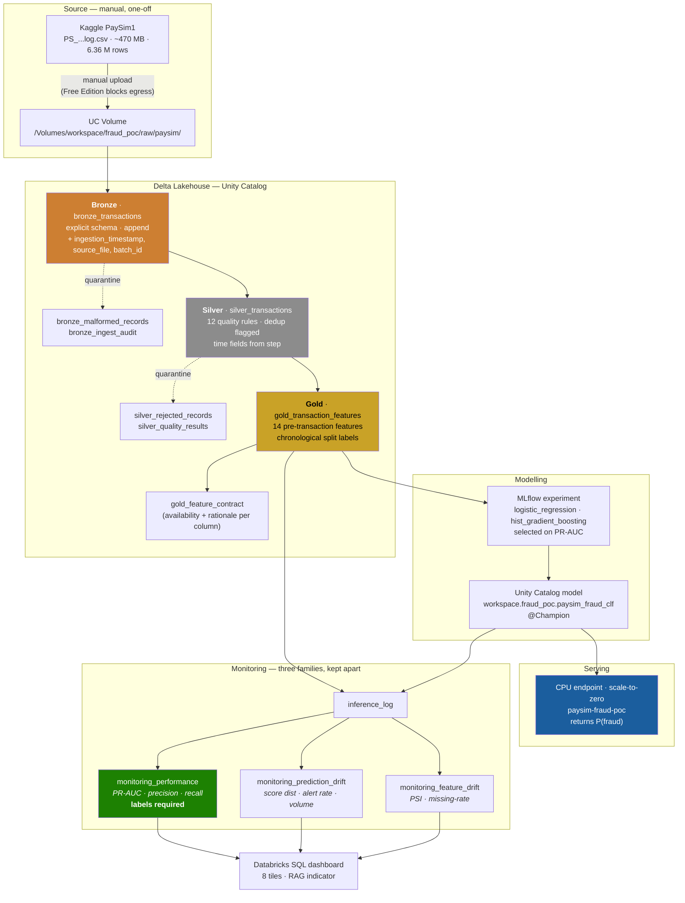

# Real-Time Mobile Payment Fraud Detection Lakehouse

An end-to-end fraud detection proof of concept on **Databricks Free Edition**:
PaySim CSV → Delta medallion (Bronze/Silver/Gold) → MLflow experiment → Unity
Catalog model → scale-to-zero CPU serving endpoint → drift monitoring tables →
**fraud loss prevention simulation** → **operational replay** → three
Databricks SQL dashboards.

The end product ingests raw transaction data, transforms it through Bronze,
Silver and Gold Delta tables, trains and registers a machine learning model with
MLflow, produces fraud predictions, and presents model-monitoring, financial-
impact **and operational** dashboards. The impact dashboard translates model
predictions into estimated fraud loss prevention, review workload,
false-positive cost and net savings; the operational dashboard replays the model
hour by hour as if it had shipped, comparing fraud caught and money saved
against the cost of running the alert queue — making the PoC measurable from a
commercial as well as a technical perspective. See [Fraud Loss Prevention Simulator](#fraud-loss-prevention-simulator)
for what those estimates are, and what they are not.

## Public project scope

Source validation on 15 October 2026: **488 tests passed**, with **three optional
MLflow tests skipped** because the local MLflow dependency was unavailable.
These tests validate local contracts and calculations; they do not execute the
Databricks notebooks or confirm a live endpoint.

This repository contains the notebook source, reusable Python modules, dashboard
SQL/specifications and local tests for an educational Databricks lakehouse POC.
The original project documentation records an end-to-end execution on Databricks
Free Edition, including Unity Catalog registration and a scale-to-zero serving
endpoint. Those workspace results are historical project records; the public
source release does not verify that the endpoint is currently running.

The source data is synthetic PaySim. Ingestion and monitoring are batch-based;
“real-time” refers to the scoring interface, not a streaming ingestion pipeline.
AWS S3 storage is part of the cloud lakehouse context, accessed here through
Databricks-managed Unity Catalog volumes and tables rather than a configured
customer S3 bucket connector.

Read [The 0.999 problem](#the-0999-problem) before quoting any model metric.
The recorded 0.9994 test PR-AUC reflects simulator artefacts, not validated
real-world fraud detection. All financial impact figures are simulation
estimates under stated assumptions.

---

## Business problem

Mobile money moves in seconds and settles irreversibly. A fraudulent transfer
that completes is money gone — there is no chargeback window like a card
network's. That forces the decision **before** the payment settles, on the
information available at authorisation time, in the tens of milliseconds a
payment API can afford.

Two costs pull against each other:

- **Missed fraud** — direct loss, plus regulatory and reputational damage.
- **False positives** — a blocked legitimate transfer is a support call, an
  abandoned transaction, and often a churned customer. At 0.13 % fraud
  prevalence, a model flagging 1 % of traffic generates roughly seven false
  alarms for every genuine one.

This PoC demonstrates the machinery for making that trade-off explicit and
monitorable: a reproducible feature contract, a chronologically honest
evaluation, a deployed scoring endpoint, and drift tables that separate *"the
data changed"* from *"the model got worse"*.

---

## Architecture



### Pipeline stages

| Notebook | Produces | Key decision |
|---|---|---|
| `00_config.py` | `CFG`, helpers | Every name in one place; experiment path resolved from `current_user()`, never hard-coded |
| `01_ingest_bronze.py` | `bronze_transactions`, audit, malformed | Explicit schema, append, file-metadata-derived `batch_id` for idempotence |
| `02_transform_silver.py` | `silver_transactions`, rejects, quality results | Rejected rows are preserved with reasons; duplicates flagged, not deleted |
| `03_build_gold_features.py` | `gold_transaction_features`, contract table | Pre-transaction features only; runtime leakage guard |
| `04_train_register_model.py` | MLflow runs, UC model `@Champion` | Chronological split, PR-AUC selection, threshold chosen on validation |
| `05_deploy_and_test_endpoint.py` | Serving endpoint + sanitised evidence | `VERIFIED` only after a validated HTTP response |
| `06_generate_monitoring.py` | 7 monitoring tables | Feature / prediction / performance drift kept separate |
| `sql/07_drift_dashboard.sql` | 8 dashboard queries | Reads only small aggregates, never the 6.3 M-row Gold table |
| `08_fraud_impact_simulation.py` | `gold_fraud_impact_simulation`, `gold_fraud_business_impact_summary` | Model scores → simulated savings; every row carries the assumptions that produced it |
| `sql/09_fraud_impact_dashboard.sql` | 9 business-impact queries | Executive KPIs, threshold trade-off, review workload, recommendation |
| `dashboards/build_lvdash.py` | `fraud_drift_monitoring.lvdash.json` | Dashboard generated from the SQL file, so queries cannot drift from layout |

---

## Dataset provenance and limitations

**Source:** [PaySim1 on Kaggle](https://www.kaggle.com/datasets/ealaxi/paysim1)
(Lopez-Rojas, Elmir & Axelsson, 2016). File
`PS_20174392719_1491204439457_log.csv`, ~470 MB, 6,362,620 rows, 11 columns.
Licence: CC BY-SA 4.0. Not redistributed with this repository.

| Column | Meaning |
|---|---|
| `step` | Simulated hour. Documented as 1–744 (31×24); the shipped file actually tops out at **743** |
| `type` | `CASH_IN`, `CASH_OUT`, `DEBIT`, `PAYMENT`, `TRANSFER` |
| `amount` | Transaction amount |
| `nameOrig` / `nameDest` | Account identifiers (`C…` customer, `M…` merchant) |
| `oldbalanceOrg` / `newbalanceOrig` | Origin balance before / after |
| `oldbalanceDest` / `newbalanceDest` | Destination balance before / after |
| `isFraud` | Target — 8,213 rows, **0.129 %** |
| `isFlaggedFraud` | PaySim's own rule (transfers > 200k), 16 rows |

Note the source's inconsistent spelling: `oldbalanceOrg` (no `i`) beside
`newbalanceOrig` (with `i`). This is reproduced verbatim in
`fraud_common/schema.py` and asserted by a test.

### Limitations you must state in any write-up

1. **It is a simulation.** Agent-based synthetic data with generator artefacts,
   not real payment traffic. Absolute metrics do not transfer to production.
2. **Fraud occurs only in `TRANSFER` and `CASH_OUT`.** A real system sees fraud
   patterns in every channel. The pipeline does *not* filter on this — doing so
   would bake a simulator artefact into the model.
3. **No wall-clock time.** `step` is an hour counter. Silver anchors it to a
   synthetic epoch (2024-01-01) purely so dashboards can plot a time axis.
4. **No merchant, device, geolocation, velocity or session features.** A real
   fraud model leans heavily on cross-transaction aggregates. Only
   single-transaction features exist here.
5. **Labels are complete and instant.** In production, fraud labels arrive days
   to weeks late. Notebook 06 *simulates* that delay rather than pretending
   otherwise — see [Evaluation methodology](#evaluation-methodology).
6. **`isFlaggedFraud` is nearly useless** (16 of 8,213 fraud rows) and is
   excluded as an input regardless.
7. **PaySim is trivially separable using pre-transaction fields alone** — see
   [The 0.999 problem](#the-0999-problem). This is the single most important
   thing to say about the dataset, and it is not fixable by feature selection.

---

## The 0.999 problem

> **Headline finding of the executed run.** Test PR-AUC came out at **0.9994**.
> That is a real measurement of a trivially separable dataset, **not** evidence
> of a working fraud model. Read this section before quoting any metric.

### It is not post-transaction leakage

The obvious suspicion is that `newbalanceOrig` leaked back in. It did not. The
feature contract persisted to `gold_feature_contract` during the run confirms
all 14 served features are `pre_transaction`, and that `new_balance_orig`,
`new_balance_dest`, `is_flagged_fraud` and `is_fraud` are all excluded. The
runtime guard in notebooks 03 and 04 did its job.

### It is a generative artefact of the simulator

PaySim creates fraud by **draining the account**: the fraudster takes control
and moves the entire balance. Legitimate PaySim transactions never spend
*exactly* the full balance. So the single pre-transaction condition
`amount == old_balance_orig` separates the classes almost perfectly.

Measured on the test split (steps 632–743) during the run:

| `abs(amount - old_balance_orig) < 0.01 AND old_balance_orig > 0` | Rows | Matches |
|---|---|---|
| **All legitimate** — CASH_IN, CASH_OUT, DEBIT, PAYMENT, TRANSFER | 88,214 | **0** |
| Fraud CASH_OUT | 626 | 619 |
| Fraud TRANSFER | 626 | 584 |

**100 % precision at 96 % recall, from one equality test.** No model required.
`amount_to_balance_ratio` (≈ 1.0) and `drains_origin_account` hand exactly this
signal to the classifier, which is why PR-AUC saturates.

A subtlety worth keeping: `drains_origin_account` also fires on **31 % of
legitimate rows** dataset-wide, because it is defined with `amount >= balance`
and therefore catches overdrafts. It is the *exact equality* that is
fraud-exclusive, not the inequality.

### What this means

* Removing post-transaction leakage was **necessary but not sufficient**. There
  is a second, deeper artefact that no exclusion policy can remove, because the
  offending columns (`amount`, `oldbalanceOrg`) are genuinely known before
  authorisation. Dropping them would leave nothing to model.
* **Do not report 0.9994 as fraud-detection performance.** It measures the
  simulator, not the problem. Any real deployment would score far lower.
* The pipeline, contract enforcement, chronological split and monitoring are all
  still exercised correctly — the *engineering* is validated. Only the modelling
  result is uninformative.
* If you need a defensible modelling result, this dataset cannot give you one.
  Use a real (or adversarially resampled) dataset, or deliberately ablate the
  `amount`/`old_balance_orig` relationship and report the degraded score as the
  honest baseline.

### Split prevalence is not constant

PaySim's transaction volume collapses in later steps, so the chronological split
is very uneven by row count even though it is even by time:

| Split | Rows | Share | Fraud | Prevalence | PR-AUC no-skill baseline |
|---|---|---|---|---|---|
| train | 6,082,007 | 95.6 % | 5,781 | 0.095 % | 0.00095 |
| valid | 191,147 | 3.0 % | 1,180 | 0.617 % | 0.0062 |
| test | 89,466 | 1.4 % | 1,252 | **1.399 %** | **0.014** |

Test prevalence is **15× train**. The split remains methodologically correct —
it must be chronological — but it means:

* The no-skill PR-AUC baseline differs per split, so metrics are **not directly
  comparable across splits**.
* The headline 0.13 % prevalence figure describes the *whole file*, not the test
  period. Do not quote it alongside the test metric.
* The test set is small (89 k rows, 1,252 positives), so its metrics are noisier
  than the row count of the full dataset suggests.

---

## Setup

### Prerequisites

- A Databricks **Free Edition** account (serverless compute, Unity Catalog
  enabled — `workspace` catalog exists by default).
- Python 3.9+ locally, if you want to run the tests.
- A Kaggle account, to download the dataset.

### 1 · Local tests (no Databricks needed)

```bash
cd databricks-fraud-pipeline
python -m venv .venv && source .venv/bin/activate
pip install -r requirements-dev.txt
pytest                 # 488 tests, ~2 s
```

The whole test suite runs without Spark, MLflow-server, or a workspace
connection. `pytest.ini` puts `src/` on the path.

### 2 · Get the code into Databricks

**Option A — Git folder (recommended).**
Workspace → Create → Git folder → paste your repo URL. The notebooks import
`fraud_common` from their own directory automatically.

**Option B — Upload.**
Workspace → Import → upload the `src/` folder. Keep `fraud_common/` as a
sibling of the numbered notebooks or the bootstrap in `00_config` will not find
it.

### 3 · Create the schema and volume

Run `00_config.py`, then in any notebook:

```python
ensure_uc_objects()
```

This issues `CREATE SCHEMA IF NOT EXISTS` and `CREATE VOLUME IF NOT EXISTS`. It
deliberately does **not** attempt `CREATE CATALOG` — Free Edition already has
`workspace` and typically denies the privilege.

---

## Manual dataset upload

**Databricks Free Edition blocks outbound network access from compute.** You
cannot `kaggle datasets download`, `wget`, or `pip install kaggle` your way
around this from inside a notebook. The file must be uploaded by hand.

1. Sign in to Kaggle and download
   <https://www.kaggle.com/datasets/ealaxi/paysim1> (~180 MB zipped).
2. Unzip it locally. You want `PS_20174392719_1491204439457_log.csv` (~470 MB).
3. In Databricks: **Catalog → `workspace` → `fraud_poc` → Volumes → `raw` →
   Upload to this volume**. Create a folder `paysim` and upload the CSV into it.
   Large uploads take several minutes; do not close the tab.
4. Confirm the resulting path matches `CFG.input_path`:

   ```
   /Volumes/workspace/fraud_poc/raw/paysim/PS_20174392719_1491204439457_log.csv
   ```

   If you put it elsewhere, set the `input_path` widget on any notebook, or edit
   the default in `src/fraud_common/config.py`.

**Never commit the CSV, and never put Kaggle credentials in a notebook.**
`.gitignore` blocks `*.csv` and `kaggle.json` already.

If the file is missing, `require_input_file()` raises with these exact
instructions rather than failing obscurely three cells later.

---

## Notebook execution order

Run in order. Each depends on the previous one's tables.

| # | Notebook | Typical runtime | Produces |
|---|---|---|---|
| 0 | `00_config.py` | seconds | `CFG` — run alone first to inspect the resolved config |
| 1 | `01_ingest_bronze.py` | 3–8 min | `bronze_transactions` (6.36 M rows) |
| 2 | `02_transform_silver.py` | 3–8 min | `silver_transactions` + rejects + quality results |
| 3 | `03_build_gold_features.py` | 2–5 min | `gold_transaction_features` + contract |
| 4 | `04_train_register_model.py` | 5–15 min | MLflow runs, UC model version, `@Champion` |
| 5 | `05_deploy_and_test_endpoint.py` | 10–30 min (endpoint cold start) | Serving endpoint + sanitised evidence |
| 6 | `06_generate_monitoring.py` | 5–15 min | 7 monitoring tables |
| 7 | `sql/07_drift_dashboard.sql` | minutes (manual) | Drift dashboard |
| 8 | `08_fraud_impact_simulation.py` | 1–3 min | `gold_fraud_impact_simulation` + `gold_fraud_business_impact_summary` |
| 9 | `sql/09_fraud_impact_dashboard.sql` | generated | Business impact dashboard |
| 10 | `10_fraud_operations_timeseries.py` | 1–3 min | `gold_fraud_operations_timeseries` + `_hourly_profile` + `_summary` |
| 11 | `sql/11_fraud_operations_dashboard.sql` | generated | Operational replay dashboard |

Notebooks 1–4, 6, 8 and 10 can also be run as a job — see `databricks.yml` and
`resources/fraud_pipeline_job.yml`. Notebook 5 is deliberately excluded from the
job graph so endpoint quota is never consumed by a scheduled run.

Notebook 8 reads only `scored_predictions` (written by notebook 4), so it can be
re-run on its own: change an assumption, re-run, and both impact tables and the
whole business dashboard move in about a minute.

**Re-running:** ingestion is idempotent (same file → same `batch_id` → skipped).
Silver, Gold and monitoring overwrite their outputs, so they are safe to re-run.
Training creates a new MLflow run and a new model version each time.

---

## Databricks Free Edition limitations

These shaped real design decisions, not just caveats:

| Limitation | Consequence in this project |
|---|---|
| **No outbound network from compute** | Dataset must be uploaded by hand. No notebook attempts to download it. |
| **Serverless compute only** | No `new_cluster` in the job definition. Notebooks avoid cluster-specific tuning. |
| **Limited compute quota** | The full 6.36 M rows flow through ETL, but training uses a 10 % deterministic sample of legitimate rows (all fraud rows retained). |
| **Driver memory pressure** | Evaluation splits are collected to pandas; `eval_max_rows` caps them uniformly (prevalence preserved) if you hit OOM. |
| **Model Serving** | Works. Verified: endpoint reached `READY` and returned validated predictions. It pulls the model from UC under its own service identity, which — unlike serverless notebooks — *can* read that location. |
| **SQL warehouse auto-stops (~10 min idle)** | First dashboard query after a pause pays ~30 s cold start. All queries read small aggregates. |
| **Limited scheduled refreshes** | Refresh the dashboard manually for a demo. |
| **No `CREATE CATALOG` privilege** | `ensure_uc_objects()` only creates schema and volume, inside the existing `workspace` catalog. |

### Platform failures found by running it (not by `bundle validate`)

Every one of these passed local tests and `databricks bundle validate`, then
failed on a real serverless run. They are recorded here because the error
messages are not self-explanatory.

| Symptom | Cause | Fix applied |
|---|---|---|
| `[NOT_SUPPORTED_WITH_SERVERLESS] PERSIST TABLE` | `.cache()` / `.persist()` are rejected on serverless | Removed; counts read back from the written Delta table, which is cheaper anyway |
| `input_file_name()` unavailable | Not supported on Spark Connect | `_metadata.file_path` |
| `s3:PutObject AccessDenied` on `__unitystorage/.../models/` when registering **v2** | The serverless identity lacks write rights on the UC model storage location. v1 registered earlier in the same session, so this is a quota or intermittent-credential effect | Registration failure is no longer fatal when a usable version already exists |
| `HeadObject 400` when loading `models:/<uc>@Champion` | Same restriction on the read side — `HEAD` cannot carry an error body, so `403` surfaces as `400` | No fix available; scoring moved into notebook 04 |
| `models:/m-<uuid>` → "not a proper models:/ URI" | Runtime ships an **MLflow 2.x client** against an **MLflow 3** tracking server | — |
| `runs:/<run_id>/model` → 404 | MLflow 3 does not write that layout | — |
| DBFS artefact path → "Run 'logged_models' not found" | MLflow 2 client misparses the MLflow 3 path as a run id | — |

**Net effect:** on Free Edition you can log and register a model to Unity
Catalog, and **Model Serving can load it**, but a *serverless notebook* cannot
read it back by any route. The restriction is on the notebook identity, not on
the artefact. Registration itself is intermittent: of four attempts, v1 and v4
reached `READY` while v2 and v3 are stuck in `PENDING_REGISTRATION`. Notebook 06
therefore consumes scores written by notebook 04 while the pipeline was still in
memory. Every scored row carries
`scoring_path = training_notebook_in_memory_pipeline` so this is visible in the
data, not just in prose.

**Consequence for Model Serving:** none, as it turned out. Serving was expected
to hit the same wall and did not — it runs with a separate service identity.
Notebook 05 is still excluded from the scheduled job graph, because creating an
endpoint consumes quota and should be a deliberate act, not a side effect of a
cron trigger.

---

## Feature leakage decisions

This is the single most consequential design choice in the project.

PaySim makes models look brilliant. `newbalanceOrig` alone gives near-perfect
separation: for a fraudulent transfer, the origin balance goes exactly to zero.
Published PaySim notebooks routinely report ROC-AUC > 0.99 and PR-AUC around
0.99 on that basis.

**That signal only exists after the payment settles.** A real-time system must
decide before it settles. So this project scores under a strict
**pre-transaction** interpretation, and every column is classified by when its
value becomes known (`fraud_common/schema.py`, `GOLD_COLUMNS`).

### Excluded, and why

| Column | Class | Reason |
|---|---|---|
| `newbalanceOrig`, `newbalanceDest` | post-transaction | Settled balances. Unknowable at authorisation. **The single biggest leak.** |
| `isFlaggedFraud` | label-adjacent | Output of PaySim's own rules engine — a downstream control's decision, not an input. Using it means predicting another model. |
| `isFraud` | label | The target. |
| `nameOrig`, `nameDest` | identifier | Raw customer keys. High-cardinality, PII-shaped, and memorisable. SHA-256 hashes are kept in Gold for joins; **neither the raw value nor the hash is ever sent to the endpoint.** |
| `step` | time axis | Governs the split and the monitoring windows. Withheld so the model cannot memorise simulator time. |

Derived columns that would reintroduce a leak — most notably the popular
"balance error" features `oldbalanceOrg + amount - newbalanceOrig` — are
excluded for the same reason.

### The 14 served features

All are computable before authorisation. This list **is** the online contract:
it drives the Gold projection, the MLflow signature, and the endpoint payload,
from one declaration in `fraud_common/features.py`.

| # | Feature | Type | Available at scoring time because… |
|---|---|---|---|
| 0 | `amount` | double | It is in the authorisation request. |
| 1 | `type` | string | Channel is known when the request arrives. |
| 2 | `old_balance_orig` | double | Current balance, read before debiting. |
| 3 | `old_balance_dest` | double | Current destination balance. |
| 4 | `hour_of_day` | int | From the request clock. |
| 5 | `is_night` | int | Derived from hour; fraud concentrates overnight. |
| 6 | `day_of_week` | int | From the request clock. |
| 7 | `amount_to_balance_ratio` | double | `amount / (old_balance_orig + 1)`; near 1.0 = drain. |
| 8 | `drains_origin_account` | int | Amount empties the account, within cent tolerance. |
| 9 | `exceeds_origin_balance` | int | Amount exceeds available balance. |
| 10 | `dest_is_merchant` | int | Account **type** (`M` prefix), known pre-authorisation. Derived from `nameDest`, but the identifier itself never leaves the lakehouse. |
| 11 | `orig_balance_is_zero` | int | Mule-account signal. |
| 12 | `dest_balance_is_zero` | int | Fresh/dormant destination. |
| 13 | `amount_log` | double | `ln(1 + amount)`; linearises the heavy tail for the LR baseline. |

`dest_is_merchant` is the one judgement call. It is derived from an identifier,
which usually smells of leakage — but it encodes an account *type* that every
payment processor knows before authorising, and the raw key is never exposed. It
is documented in `GOLD_COLUMNS` and asserted by a test rather than left implicit.

### How the guarantee is enforced

- `schema.assert_no_leakage()` runs at **runtime** in notebooks 03 and 04, not
  only in tests.
- `features.assert_feature_contract_consistent()` runs at import time in
  `00_config`, so `schema.py` and `features.py` cannot silently diverge.
- `tests/test_schema_contract.py` parametrises over every forbidden column.
- `tests/test_features_and_config.py` asserts no served SQL expression even
  *mentions* a post-transaction column.

**Expect lower numbers than the PaySim notebooks you will find online. That gap
is the leakage.** Reporting 0.99 PR-AUC here would mean the leak is back.

---

## Evaluation methodology

### Chronological split — never random

| Split | Steps (of 743) | Share | Purpose |
|---|---|---|---|
| Train | 1 – 520 | earliest 70 % | Fit |
| Validation | 521 – 631 | next 15 % | Model selection **and** threshold choice |
| Test | 632 – 743 | final 15 % | Reported once, never tuned against |

These are the boundaries `compute_boundaries()` produces for the real file
(verified locally). They are computed from the *observed* min/max `step` at
runtime, not hard-coded, so a subset or a different vintage of the file
re-derives them automatically.

Cut on the `step` **range**, not row count: PaySim's hourly volume is very
uneven, and a row-count cut would place a boundary mid-hour, putting the same
hour on both sides of it. `splits.assert_chronological()` enforces
non-overlapping ranges at runtime, and a test proves a shuffled split is caught.

### Sampling — deterministic, minority class untouched

Training keeps **every fraud row** in the training period and thins legitimate
rows to 10 % via `SHA-256(seed:transaction_id) < 0.10`. A hash rather than
`.sample(seed=)` because the latter is not stable across repartitioning; the
divisor is `2**60`, exactly representable in IEEE-754, so Spark and pandas
compute byte-identical ratios and select identical rows.

**Validation and test keep their natural 0.13 % prevalence.** Balancing them
would make precision a fiction. If driver memory forces a cap, `eval_max_rows`
thins uniformly across both classes, preserving prevalence.

### Metrics

**Primary: PR-AUC (average precision).** At 0.13 % prevalence:

- *Accuracy* is 99.87 % for a model that never predicts fraud. Useless.
- *ROC-AUC* flatters any ranker, because the true-negative pool is enormous.
- *PR-AUC* has a no-skill baseline equal to prevalence (0.0013), so it only
  rewards ranking real fraud above real legitimate traffic.

`metrics.compare_models()` selects on PR-AUC only, and a test proves a model
with better ROC-AUC but worse PR-AUC loses.

Also reported: ROC-AUC, precision, recall, F1, false-positive rate, confusion
matrix, predicted-positive rate, alerts per 1,000 transactions, and
**fraud amount captured** — the money-weighted view a payments business actually
cares about.

### Operating threshold

Chosen on **validation only** as the highest-recall point whose false-positive
rate stays within `target_max_fpr` (default 1 %), then frozen. Tuning it on test
would leak the test set into the reported operating point. A full threshold
sweep is logged as `test_threshold_sweep.csv`.

### Models

1. **Logistic regression** — baseline, `class_weight="balanced"`, standardised
   numerics, one-hot `type`.
2. **HistGradientBoostingClassifier** — challenger, balanced sample weights.
   Chosen because it ships with scikit-learn, so Free Edition needs no extra
   library.

No hyperparameter search. This is a one-day PoC; tuning would not change the
architecture it demonstrates.

---

## Deployment

Notebook 05 creates one **scale-to-zero CPU** endpoint (`paysim-fraud-poc`),
waits for READY, and sends two requests: the canonical fabricated example and a
batch of real Gold test-period rows.

**The honesty rules it enforces:**

- `VERDICT = "VERIFIED"` is set in exactly one place, only after an HTTP
  response is received *and* its prediction structure validated. A test asserts
  this.
- **No local fallback.** A test asserts the notebook contains no reference to
  `flask`, `fastapi`, `uvicorn` or `http.server`. If Databricks serving is
  unavailable, the notebook fails and says so.
- Authentication is entirely ambient (Databricks SDK). No token is read,
  printed, stored or passed. All evidence passes through
  `serving.sanitize_evidence()`, which redacts secret-shaped keys, bearer
  tokens, `dapi…` PATs and credentials embedded in URLs.

### Endpoint request example

The model is logged with `pyfunc_predict_fn="predict_proba"`, so it returns a
**probability pair**, not a hard label — drift monitoring needs a score, and a
threshold has to remain tunable after deployment.

Request:

```json
{
  "dataframe_records": [
    {
      "amount": 181.0,
      "type": "TRANSFER",
      "old_balance_orig": 181.0,
      "old_balance_dest": 0.0,
      "hour_of_day": 1,
      "is_night": 1,
      "day_of_week": 0,
      "amount_to_balance_ratio": 0.9945054945054945,
      "drains_origin_account": 1,
      "exceeds_origin_balance": 0,
      "dest_is_merchant": 0,
      "orig_balance_is_zero": 0,
      "dest_balance_is_zero": 1,
      "amount_log": 5.204006687076795
    }
  ]
}
```

Response (**actual**, from the verified run):

```json
{ "predictions": [[0.001195853611119957, 0.99880414638888]] }
```

Element `[1]` is P(fraud) — 0.9988 for that example, which is an exact
account-drain and therefore trivially separable (see
[The 0.999 problem](#the-0999-problem)).

Verified against a mixed sample of 5 real Gold test rows:

| Ground truth | Scores | Mean |
|---|---|---|
| legitimate (3 rows) | 0.00106, 0.00121, 0.00121 | **0.00116** |
| fraud (2 rows) | 0.99880, 0.99880 | **0.99880** |

`separates_classes: true`, 3 distinct scores, 30–150 ms latency. The smoke test
deliberately sends a *mixed* sample: an earlier version used a plain `LIMIT 5`,
which returned five consecutive fraud rows that all scored identically — a
result indistinguishable from an endpoint returning a constant.

Element `[1]` is P(fraud). `serving.extract_scores()` handles this and the two
other shapes MLflow can emit, and `validate_scores()` rejects anything outside
`[0, 1]` or NaN.

From a notebook (no token handling):

```python
from databricks.sdk import WorkspaceClient
from fraud_common import serving

w = WorkspaceClient()
payload = serving.example_payload()
response = w.serving_endpoints.query(
    name="paysim-fraud-poc",
    dataframe_records=payload["dataframe_records"],
)
scores = serving.extract_scores(response.as_dict()["predictions"])
```

Column order is normalised to the signature before sending, so a reordered
frame cannot produce a 400.

### If deployment is blocked

Notebook 05 prints the shortest resolution path for the actual error:

1. **Serving tab absent** → Model Serving is not enabled for this
   workspace/edition. Everything up to and including registration still stands;
   report it as such.
2. **Quota error** → Serving → ⋯ → Delete another endpoint, re-run.
3. **Permission error** → `GRANT EXECUTE ON MODEL workspace.fraud_poc.paysim_fraud_clf TO \`<principal>\`;`
4. **`PENDING_REGISTRATION`** → wait for the UC scan, re-run.

---

## Dashboard creation

There are **two dashboards**:

| Dashboard | Source | Answers | X-axis |
|---|---|---|---|
| Drift watch | `sql/07_drift_dashboard.sql` | Is the model still healthy? | monitoring window |
| Business impact | `sql/09_fraud_impact_dashboard.sql` | Which threshold should we run? | threshold |
| Operational replay | `sql/11_fraud_operations_dashboard.sql` | We shipped it — how is it going? | **clock time** |

**All three are generated from their SQL file** by `dashboards/build_lvdash.py` and
deployed by the bundle — no manual build step:

```bash
python dashboards/build_lvdash.py           # regenerate all three .lvdash.json
python dashboards/build_lvdash.py --check   # CI: fail if any is stale
databricks bundle deploy -t dev --var="warehouse_id=<id>"
```

The SQL file is the source of truth in both cases; the JSON holds only layout,
so a query can never drift from the tile that renders it. See
[Fraud Loss Prevention Simulator](#fraud-loss-prevention-simulator) for how to
read the impact page.

Two routes to the same eight **drift** tiles. **Import the generated dashboard**
if you just want it on screen; **build it by hand** if you want to see each query
and visualisation choice made explicitly (the original PoC path, kept below).
The impact dashboard follows Route A only; its SQL file carries hand-build
instructions too if you prefer to assemble it yourself.

### Route A — import the generated Lakeview dashboard

`dashboards/fraud_drift_monitoring.lvdash.json` holds the whole dashboard:
nine datasets and eleven widgets, laid out as the table further down describes.

```bash
# regenerate after editing the SQL (the JSON is derived, never hand-edited)
python dashboards/build_lvdash.py
python dashboards/build_lvdash.py --check   # CI guard: fails if stale

# import
databricks lakeview create --json @dashboards/fraud_drift_monitoring.lvdash.json
```

or **SQL → Dashboards → ⋯ → Import dashboard from file**.

To deploy it with the bundle instead, pass the warehouse the tiles should run
on — it is workspace-specific, so it is a variable rather than a committed
value:

```bash
databricks warehouses list
databricks bundle deploy -t dev --var="warehouse_id=<id>"
```

The queries are **parsed out of `sql/07_drift_dashboard.sql` verbatim** by the
generator. That file stays the reviewed artefact — the JSON carries layout only,
so a threshold can never be right in one place and stale in the other. Search
and replace `workspace.fraud_poc` in the SQL, not in the JSON, then regenerate.

Q2 and Q3 are true `heatmap` widgets, and the PSI columns on Q6 carry
conditional cell colouring (RED `#d13212` ≥ 0.25, AMBER `#e8a33d` ≥ 0.10, GREEN
`#1d8102`). One limit remains: cell rules compare **numerically**, so the colour
hangs off `worst_feature_psi` and `prediction_score_psi` rather than off the
`overall_status` string beside them. Colour the status strings by hand on the
tile if you want them too.

**Two things that bite when hand-editing this JSON** — both cost a debugging
session here, and both are asserted by `tests/test_dashboard_spec.py`:

- **The widget `version` is what the renderer dispatches on.** A `table` at
  version 1 is accepted by the API, round-trips through `lakeview get`
  unchanged, and then renders as *"Visualization has no fields selected"* — and
  is silently dropped the first time someone saves the dashboard in the UI.
  Tables are **version 2**; `bar`, `line` and `heatmap` are **version 3**.
- **The grid is 12 columns wide**, and every row should sum to exactly 12.

### Route B — build it by hand

1. **SQL → Queries → Create query.** Paste one block from
   `sql/07_drift_dashboard.sql`, run it, save under the name in its header.
   Repeat for Q1–Q8. (Search-and-replace `workspace.fraud_poc` first if you
   changed the catalog or schema.)
2. Set the visualisation each header specifies — Q6 is a table with a colour
   rule on `overall_status` (RED `#d13212`, AMBER `#e8a33d`, GREEN `#1d8102`).
3. **SQL → Dashboards → Create dashboard → Add → Visualization**, pick each
   saved query.
4. Arrange:

   | Row | Left | Right |
   |---|---|---|
   | 1 | **Q6 RAG indicator** (full width) | |
   | 2 | Q1 Transaction volume | Q4 Predicted-positive rate |
   | 3 | Q2 Score distribution | Q5 Precision / recall (labelled only) |
   | 4 | Q3 Feature PSI | Q3b Missing-rate change |
   | 5 | Q7 Data quality | Q8 Feature contract |

The tiles map to the required views: volume over time (Q1), fraud-score
distribution over time (Q2), PSI/drift status by feature and window (Q3),
predicted-positive rate (Q4), precision and recall where labels exist (Q5), and
the red/amber/green indicator (Q6).

---

## Drift monitoring — what each table can and cannot prove

Notebook 06 computes three **separate** families and never conflates them:

| Family | Table | Question | Labels? | What it does **not** prove |
|---|---|---|---|---|
| **Feature drift** | `monitoring_feature_drift` | Did the inputs move? | No | That the model got worse. A marketing campaign shifts `amount` with no change in fraud behaviour. |
| **Prediction drift** | `monitoring_prediction_drift` | Did scores / alert rate move? | No | That the model got worse. It is a symptom worth alerting on because it is observable *immediately*. |
| **Performance** | `monitoring_performance` | Did PR-AUC / precision / recall fall? | **Yes** | Nothing — but only computable once labels arrive. |

Statistics computed: PSI for every numeric feature (quantile-binned on the
frozen training reference), categorical PSI for `type`, missing-rate deltas,
score distribution (mean, median, p90, p99, 20-bucket histogram), predicted-
positive rate, transaction volume, and PR-AUC / precision / recall / FPR /
confusion matrix / fraud value captured where labels exist.

PSI convention: `< 0.10` stable · `0.10–0.25` investigate · `> 0.25` significant.
A window with no data is **AMBER**, never GREEN — unknown must not read as fine.

### Delayed labels are simulated deliberately

Fraud labels arrive days to weeks late. The last `label_delay_windows`
(default 2) windows are marked `label_available = false` and get **no**
performance row. The dashboard's Q5 uses a `LEFT JOIN` so those windows appear
as `AWAITING LABELS` with NULL metrics rather than vanishing — a missing window
would read as "fine"; a NULL reads as "not yet knowable".

Q6's `interpretation` column spells this out: when inputs shifted but labels
have not arrived, it says *"Degradation is NOT established — investigate, do not
retrain on this signal alone."*

---

## Fraud Loss Prevention Simulator

Everything before this point answers *is the model any good?* This layer answers
the question a business sponsor actually asks:

> **If this fraud detection model were used to block or review suspicious
> transactions, how much money could the business potentially save?**

> ⚠️ **The savings shown are simulated estimates based on historical transaction
> labels, model predictions, and configurable business assumptions. They should
> not be interpreted as guaranteed real-world savings without production
> validation.**

That caveat is not decoration. It is written into `impact.DISCLAIMER`, stored on
every row of the summary table as `result_disclaimer`, printed by the notebook,
asserted by `tests/test_impact.py`, and reproduced at the top of the dashboard
SQL — so a screenshot of any tile carries it too.

### What it does

`src/08_fraud_impact_simulation.py` sweeps the decision threshold from 0.05 to
0.95, and at each point asks: which transactions would have been flagged, how
much fraud value would that have caught, what would the review queue have cost,
and what is the difference worth?

```
scored_predictions (fraud_score, label_true, amount)
        │
        ├─ threshold 0.05 ─┐
        ├─ threshold 0.10 ─┤  confusion counts + amount splits
        ├─ …               ├─ (one Spark aggregation pass, not 19)
        └─ threshold 0.95 ─┘
                           │
                           ▼   fraud_common.impact.derive_impact_row
                    financial model
                           │
        ┌──────────────────┴───────────────────┐
        ▼                                      ▼
gold_fraud_impact_simulation        gold_fraud_business_impact_summary
   (19 rows, one per threshold)        (1 row, recommended threshold)
        │                                      │
        └────────── sql/09_fraud_impact_dashboard.sql ──────────┘
```

### The three ingredients — and which one is a guess

| Ingredient | Source | Status |
|---|---|---|
| Which transactions were fraud | `label_true` | Historical fact (within the simulation) |
| Which the model would flag | `fraud_score >= threshold` | Model output, reproducible |
| What a stopped fraud is worth, what a review costs | `impact_*` in `config.py` | **Assumed** — supplied by the business |

The third is the one that decides the headline number, so it travels with every
figure: each output row carries `assumption_prevention_rate`,
`assumption_cost_per_review`, `assumption_customer_friction_cost` and
`assumption_analyst_daily_capacity`, and query **A3** puts them on the dashboard
next to the KPI tiles.

### Assumptions

| Assumption | Default | Meaning | Why it is not 1.0 / 0 |
|---|---|---|---|
| `prevention_rate` | `0.80` | Share of a flagged fraud's value actually recovered | A review takes time, some funds have already moved, some blocks are overridden |
| `cost_per_review` | `5.00` | Fully-loaded cost of one manual review | Charged on **every** flagged row — the queue cannot tell a true positive from a false one until it is worked |
| `customer_friction_cost` | `10.00` | Cost of wrongly stopping a genuine customer | Charged on false positives **in addition** to the review cost: support contact, abandoned payment, goodwill |
| `analyst_daily_capacity` | `200` | Alerts one analyst clears per working day | Turns alert volume into a staffing question rather than an abstract count |
| `currency` | `"USD"` | Label only — no FX conversion happens | |
| `impact_evaluation_split` | `"test"` | Which split is simulated | `test` is the only split both held out from training **and** never used to pick the operating threshold |

Change them in three places, in increasing order of permanence:

```bash
# 1. one run, from the notebook widgets (a live demo)
#    Widgets appear at the top of every notebook: impact_prevention_rate, …

# 2. one job run, without touching code
databricks bundle run fraud_pipeline -t dev \
  --var="impact_prevention_rate=0.6" --var="impact_cost_per_review=12"

# 3. the project default
#    edit src/fraud_common/config.py (and mirror it in databricks.yml)
```

### Tables it creates

**`gold_fraud_impact_simulation`** — one row per threshold. Columns:

| Group | Columns |
|---|---|
| Population | `total_transactions`, `total_transaction_amount`, `actual_fraud_count`, `actual_fraud_amount` |
| Confusion | `flagged_transaction_count`, `flagged_transaction_amount`, `true_positive_count`, `false_positive_count`, `false_negative_count`, `true_negative_count` |
| Fraud value | `detected_fraud_amount`, `missed_fraud_amount` |
| Money | `gross_estimated_savings`, `review_cost`, `false_positive_friction_cost`, `estimated_net_savings` |
| Rates | `fraud_detection_rate`, `precision`, `recall`, `false_positive_rate` |
| Operations | `average_saving_per_review`, `estimated_review_days_required`, `alerts_per_1k_transactions` |
| Provenance | `source_table`, `evaluation_split`, `score_column`, `score_mode`, `model_version`, `scoring_path`, `simulated_at`, `currency`, `result_disclaimer`, `assumption_*` |

**`gold_fraud_business_impact_summary`** — one row, at the recommended
threshold: everything above plus `recommended_threshold`, `selection_basis`,
`recommendation_note` (the sentence a slide can quote verbatim),
`business_override_note` and `threshold_count_simulated`.

### How the metrics are calculated

The whole financial model is five lines, defined once in
`fraud_common.impact.derive_impact_row` and called by both the notebook and the
tests, so the dashboard and the test suite cannot disagree:

```python
gross_estimated_savings      = detected_fraud_amount   * prevention_rate
review_cost                  = flagged_count           * cost_per_review
false_positive_friction_cost = false_positive_count    * customer_friction_cost
estimated_net_savings        = gross_estimated_savings - review_cost \
                                                       - false_positive_friction_cost
average_saving_per_review    = estimated_net_savings   / flagged_count
estimated_review_days_required = flagged_count / analyst_daily_capacity
```

Two details that are easy to get quietly wrong, and are pinned by tests:

- **Reviews are charged on false positives too.** Charging them only on true
  positives would flatter the business case at exactly the thresholds that
  generate the most noise.
- **`fraud_detection_rate` is money-weighted, not count-weighted.** It is
  `detected_fraud_amount / actual_fraud_amount`, not recall. 80 % recall sounds
  strong right up until the missing 20 % turns out to be the large-value
  transactions.

The flag rule is `score >= threshold`, matching `metrics.confusion_at_threshold`
and notebook 06's `predicted_label` — the same operating point means the same
thing in all three places.

**What is deliberately *not* modelled:** recovery on missed fraud, the
time-value of a blocked payment, lifetime value lost to a churned customer, and
the fixed cost of running the platform. Adding them is a business decision, not
a code change — and treating them as zero is more honest than inventing a number.

### Choosing the operating threshold

The recommendation is simply the row with the highest `estimated_net_savings`
(ties break toward the higher threshold, i.e. the smaller review queue). It is a
**starting point for a conversation, not a decision** — net savings is one scalar
built on assumed costs, and a real operating point also has to fit the review
capacity that actually exists and the organisation's tolerance for stopping good
customers. Query **F2** exists for exactly this: if 0.40 and 0.50 are worth
within a percent of each other, "the optimum is 0.45" is noise, and the choice
should be made on capacity instead.

### How to read the dashboard

`sql/09_fraud_impact_dashboard.sql` has six sections; build them in order.

| Section | Tile | Read it as |
|---|---|---|
| **A** | Executive KPIs + assumptions | The headline, immediately followed by the numbers it depends on. If A3 looks wrong to a stakeholder, stop and fix the assumption before discussing A1. |
| **B** | Threshold trade-off | *Why* the recommendation sits where it does: gross savings and costs both fall as the threshold rises, at different rates, so net savings peaks in between. A flat peak means the choice barely matters. |
| **C** | Fraud caught vs missed | Recall, in money. The two bars always sum to `actual_fraud_amount`. |
| **D** | Review workload | The reality check. Can the team actually work this queue? A threshold needing forty analyst-days per batch is not an option however good it looks in B. |
| **E** | Model quality vs business value | The bridge between the two dashboards: the threshold that maximises money is rarely the one that maximises F1, because a false positive and a true positive are not worth the same. |
| **F** | Recommendation | The conclusion, its basis, and the validation caveat, in words a slide can quote. |

Both tables are under 30 rows, so the whole page scans a few kilobytes — the
same Free Edition budget rule the drift dashboard follows.

### Why this makes the PoC business-oriented

A monitoring dashboard tells a fraud team whether the model is healthy. It tells
a sponsor nothing about whether to fund it. This layer converts the same
predictions into the four quantities a payments business runs on — fraud value
prevented, alert volume, false-positive cost, and net benefit — and makes the
assumptions behind them explicit enough to argue with. The argument is the point:
a stakeholder who changes `prevention_rate` to 0.5 and re-runs gets a new number
in a minute, which is a far better conversation than defending a single figure.

### Limitations

1. **PaySim is synthetic.** The `amount` distribution and fraud patterns are a
   simulator's, so the absolute money figures are illustrative only. Read
   [The 0.999 problem](#the-0999-problem) first — the model's separability is a
   generative artefact, which means the simulated savings inherit that
   optimism. **The shape of the trade-off is the transferable finding; the
   dollar amounts are not.**
2. **Assumptions are placeholders,** not measured operating costs. Nobody has
   validated 0.80 prevention or $5 reviews against a real fraud operation.
3. **Static costs.** Real per-review cost rises as the queue grows past capacity
   and analysts are pulled from other work; here it is linear at every volume.
4. **No feedback loop.** Blocking fraud changes fraudster behaviour. A model
   operated at a threshold does not keep the performance it showed on rows
   scored offline at that threshold.
5. **Perfect hindsight labels.** `label_true` is fully known here. In production
   labels arrive weeks late (see [Delayed labels](#delayed-labels-are-simulated-deliberately)),
   so a same-period impact figure is never actually computable in real time.
6. **One period, one model version.** No confidence interval, no seasonality, no
   bootstrap — a single point estimate on the test split.
7. **Costs of the platform itself are excluded**, so `estimated_net_savings` is
   a gross-of-infrastructure benefit, not a P&L line.

---

## Operational Replay — the model on a clock

The third dashboard. The other two are cross-sections; this is the only page
whose x-axis is **time**.

| Dashboard | Question | X-axis |
|---|---|---|
| 07 drift watch | Is the model still healthy? | monitoring window |
| 09 business impact | Which threshold should we run? | threshold |
| **11 operational replay** | **We shipped it — how is it going?** | **clock time** |

`src/10_fraud_operations_timeseries.py` takes **one frozen threshold** and
replays it hour by hour over the post-training period: how many frauds were
caught, how much money that saved, what the alert queue cost to work, and
whether the staffed team could keep up.

### Two caveats that change how every tile is read

> **The dates are synthetic.** PaySim ships no wall-clock timestamps, only
> `step` — an hour counter. Silver anchors it to `SIMULATION_START_TS`
> (2024-01-01) purely so a chart can have a time axis. The derivation is shared
> with notebook 02 via `schema.step_to_timestamp_sql()`, so the two dashboards
> cannot drift onto different clocks — but no claim is made that anything
> happened on these dates.

> **This is a replay, not a production record.** The model is applied to
> transactions it did not influence. In reality blocking fraud changes fraudster
> behaviour, reviewed alerts generate labels that change what the next model
> learns, and a desk works a queue with a delay. None of that is modelled.

And the same disclaimer as the impact simulator: the savings are simulated
estimates under configurable assumptions, not guaranteed real-world savings.

### The frozen threshold

Not re-optimised per period — re-choosing it every hour would be hindsight no
production desk has. Resolution order:

1. `ops_threshold_override`, when set
2. `recommended_threshold` from notebook 08's summary table
3. `CFG.operational_threshold` — what notebook 04 chose on validation

Whichever was used is recorded in `threshold_source` on every output row, so a
tile can never be read against the wrong operating point.

### Operational cost — one definition, two dashboards

```
operational_cost = review_cost + false_positive_friction_cost
```

Exactly the two components dashboard 09 subtracts. Inventing a third definition
here would make the two pages quietly incomparable, so the money arithmetic is
delegated to the same `impact.derive_impact_row` in both. What notebook 10 adds
is the operational overlay:

| Column | Meaning |
|---|---|
| `savings_to_cost_ratio` | Gross savings per 1 unit of operational cost — unitless, so it survives a change of currency |
| `review_capacity` | `analysts × daily capacity`, scaled to the period grain |
| `capacity_utilisation` | Alerts ÷ capacity |
| `queue_backlog_count` | Alerts above capacity. They do not vanish — a fraud desk usually fails by being *behind*, not by being wrong |
| `cumulative_*` | Running totals since go-live — the payback curve |

### Configuration

| Setting | Default | Meaning |
|---|---|---|
| `ops_evaluation_split` | `holdout` | valid + test = the whole post-training period, the honest analogue of "everything since go-live" |
| `ops_time_grain` | `hour` | PaySim's `step` *is* an hour, so hourly is the native grain and needs no interpolation |
| `ops_analyst_headcount` | `3` | Sets the capacity line. Changing it moves no savings figure — only whether the queue fits |
| `ops_threshold_override` | `None` | Pin the replay threshold instead of inheriting notebook 08's recommendation |

### Tables it creates

| Table | Grain | Feeds |
|---|---|---|
| `gold_fraud_operations_timeseries` | one row per hour | every time-series tile |
| `gold_fraud_operations_hourly_profile` | one row per hour of day | shift planning (do we need a night shift?) |
| `gold_fraud_operations_summary` | one row | the since-go-live KPI tiles |

### How to read the dashboard

| Section | Tile | Read it as |
|---|---|---|
| **T** | Return per unit spent + roll-up | Opens on the *ratio*, not the raw number — it needs no currency and no context to land |
| **U** | Savings vs operational cost; the payback curve | The core of the page. Cost is smooth (it tracks alert **volume**); savings are spiky (they track transaction **value**). That contrast is expected, not an anomaly |
| **V** | Fraud caught vs missed, by count *and* by value | Read together: a period where the counts look fine and the values do not is a period that missed the expensive ones |
| **W** | Alerts vs capacity; load by hour of day | Changes the conversation from accuracy to staffing — the part no model metric can answer |
| **X** | Precision/recall on the clock; worst periods | Noisy on low-volume hours by construction: a period with two frauds has a recall of 0, 50 or 100 % and nothing in between |

### Limitations

Everything in [Fraud Loss Prevention Simulator](#fraud-loss-prevention-simulator)
applies, plus four specific to the time axis:

1. **No feedback loop, and here it bites harder.** Over a long replay the
   assumption that fraud is unaffected by the model becomes progressively less
   defensible.
2. **Alerts are assumed worked within their own period.** A real desk carries a
   queue across shift boundaries; `queue_backlog_count` measures the overflow
   but does not roll it forward into the next hour.
3. **Fixed staffing.** `ops_analyst_headcount` is constant across the whole
   period. No holidays, no surge cover, no attrition.
4. **A short window.** The holdout split is roughly a week of synthetic hours —
   enough to show shape, nowhere near enough for a seasonality claim.

---

## Expected demo flow

Roughly 20 minutes once the tables exist:

1. **Problem** (1 min) — irreversible settlement, 0.13 % prevalence, the
   false-positive cost.
2. **`gold_feature_contract`** (3 min) — query it, filter
   `served_to_endpoint = false`, and walk the exclusion reasons. *This is the
   part that distinguishes the project from a Kaggle notebook.*
3. **`silver_quality_results`** (2 min) — 12 rules, rejected rows preserved,
   Bronze = Silver + rejects reconciliation.
4. **MLflow experiment** (3 min) — two runs, selection on PR-AUC not ROC-AUC;
   note that the numbers are modest *because* the leak is gone.
5. **Serving endpoint** (3 min) — send the example payload live, show the
   probability pair.
6. **Drift dashboard** (5 min) — start at Q6. Point out that recent windows read
   `UNKNOWN` for performance. Then Q3 (which feature moved), then Q5 (where a
   degradation claim would actually have to be proven).
7. **Business impact dashboard** (4 min) — deployed with the bundle, same as the
   drift page. A1 for the headline, then *immediately*
   A3 so the assumptions land before anyone believes the number. B1 shows why the
   recommended threshold sits where it does; D1 asks whether the review team could
   actually work that queue. Close on F1, which states the recommendation and the
   validation caveat in the same sentence. If someone disputes an assumption,
   change the widget and re-run notebook 08 live — it takes about a minute.
8. **Operational replay** (4 min) — the only page on a clock. Open on T2 (the
   return ratio), then U2, the payback curve. U1 shows the two forces under it —
   say why cost is smooth and savings are spiky. Then W1/W2, which turn the
   conversation from accuracy into staffing. Say both caveats out loud:
   synthetic dates, and a replay rather than a production record.
9. **Close** (2 min) — production-hardening list below.

The strongest moment is step 6: most monitoring demos claim drift proves decay.
This one refuses to. The most *useful* moment is step 7, where the model stops
being a PR-AUC and starts being a number a sponsor can act on — provided the
"simulated estimate" caveat is said out loud every time.

---

## Verification status

The following table records the original workspace execution. It is not a fresh live-workspace verification for this source release.

Workspace: AWS Free Edition, catalog `workspace`, schema `fraud_poc`.

| Item | Created locally | Executed in Databricks | Verified |
|---|---|---|---|
| `fraud_common` library | ✅ | — | ✅ 488 local tests |
| Source dataset contract | — | — | ✅ full-file scan + Bronze audit agree exactly |
| Notebooks 00–04, 06 | ✅ | ✅ | ✅ |
| Notebook 05 (serving) | ✅ | ✅ | ✅ |
| Bronze table | ✅ | ✅ | ✅ 6,362,620 rows, 0 malformed, 0 nulls |
| Silver + rejects + quality | ✅ | ✅ | ✅ 9 reject rules, 0 failures, 0 row loss |
| Gold + feature contract | ✅ | ✅ | ✅ 14 served features, all `pre_transaction` |
| MLflow experiment + runs | ✅ | ✅ | ✅ parent + 2 nested runs |
| UC model `paysim_fraud_clf` | ✅ | ✅ | ✅ **v1 + v4 `READY`**; `@Champion` → **v4** |
| UC model v2, v3 | ✅ | ✅ | ❌ stuck `PENDING_REGISTRATION` — S3 `AccessDenied` on `PutObject`. Registration is **intermittent**, not blocked. |
| Batch scores (`scored_predictions`) | ✅ | ✅ | ✅ 281k rows |
| Monitoring tables (7) | ✅ | ✅ | ✅ populated, queried below |
| Dashboard SQL | ✅ | ✅ (RAG rollup query) | ✅ returns correct shape |
| Serving endpoint `paysim-fraud-poc` | ✅ | ✅ | ✅ `READY`, scale-to-zero CPU, serving v4 |
| Endpoint invocation | ✅ | ✅ | ✅ classes separate, 30–150 ms |

**Model *serving* works; model *loading from a notebook* does not.** Model
Serving pulls the artefact from Unity Catalog under its own service identity and
succeeds. Serverless notebooks, running as the user, cannot read the same
location. Notebook 06 therefore does *not*
load the registered model — it consumes scores that notebook 04 wrote while the
pipeline was still in memory (`scoring_path = training_notebook_in_memory_pipeline`,
stamped on every row). The drift tables are real; they do **not** demonstrate
that the registered Unity Catalog artefact can be loaded or served. See
[Free Edition limitations](#databricks-free-edition-limitations).

---

## Executed run — monitoring results

Six equal-width `step` windows over the post-training period, labels withheld
for the most recent two.

| Window | Steps | Rows | Feature drift | Prediction drift | Performance | PR-AUC |
|---|---|---|---|---|---|---|
| w00 | 521–557 | 86,674 | RED | AMBER | GREEN | 1.0000 |
| w01 | 558–594 | 70,359 | RED | AMBER | GREEN | 1.0000 |
| w02 | 595–632 | 34,122 | RED | RED | GREEN | 1.0000 |
| w03 | 633–669 | 20,932 | RED | RED | GREEN | 0.9999 |
| w04 | 670–706 | 59,527 | RED | RED | **UNKNOWN** | — |
| w05 | 707–743 | 8,999 | RED | RED | **UNKNOWN** | — |

**This is the result the whole monitoring design exists to produce.** Feature
drift is RED in every window and prediction drift reaches RED, while measured
performance stays GREEN wherever labels exist. Retraining on the drift signal
alone would have replaced a model that was performing perfectly. The two most
recent windows show the delayed-label state: drift is visible, degradation is
*not knowable yet*, and the dashboard says `UNKNOWN` rather than a reassuring
green.

### Not all drift is equal — read the feature table before believing the alarm

| Feature | Mean PSI | Max PSI | RED windows |
|---|---|---|---|
| `day_of_week` | 8.44 | 10.97 | 6 / 6 |
| `hour_of_day` | 1.29 | 1.95 | 6 / 6 |
| `orig_balance_is_zero` | 0.16 | 0.90 | 1 / 6 |
| `amount_to_balance_ratio` | 0.10 | 0.51 | 1 / 6 |
| `old_balance_orig` | 0.09 | 0.50 | 1 / 6 |
| `drains_origin_account` | 0.07 | 0.42 | 1 / 6 |
| `old_balance_dest` | 0.02 | 0.10 | 0 / 6 |
| `is_night` | 0.01 | 0.04 | 0 / 6 |

The top two are **structural artefacts, not data drift.** `day_of_week` and
`hour_of_day` are derived from `step`, and the training period is not a whole
number of weeks — so a chronological split *guarantees* the calendar phase
differs between reference and monitoring windows. PSI 8.4 on `day_of_week`
measures "time moved forward", nothing more.

Two consequences worth carrying into production:

* **Derived calendar features should be excluded from a drift rollup**, or
  compared like-for-like (same weekday, same hour band). Otherwise they
  permanently pin the traffic light to RED and train the on-call team to
  ignore it.
* The substantive signals here are `orig_balance_is_zero` and
  `amount_to_balance_ratio` — both genuine shifts in account behaviour, and both
  far below the calendar noise. A naive "max PSI" rollup buries them.

### Precision moves without the model changing

| Window | Prevalence | Precision | Recall |
|---|---|---|---|
| w00 | 0.43 % | 0.187 | 1.000 |
| w01 | 0.58 % | 0.609 | 1.000 |
| w02 | 1.20 % | 0.949 | 1.000 |
| w03 | 1.94 % | 0.964 | 0.998 |

Precision rises 5× across the monitoring period at a fixed threshold, driven
entirely by rising fraud prevalence. Nothing about the model changed. This is
why precision alone is a poor monitoring signal, and why the prevalence column
belongs beside it on the dashboard.

---

### Source dataset — verified

A single-pass scan of the real 471 MB file confirmed every assumption baked into
`fraud_common/schema.py`:

| Check | Declared in code | Observed |
|---|---|---|
| Row count | `EXPECTED_SOURCE_ROWS = 6_362_620` | 6,362,620 (exact) |
| Malformed rows | expect 0 | 0 field-count mismatches |
| Header | `SOURCE_COLUMNS` (11, incl. the `oldbalanceOrg`/`newbalanceOrig` spelling) | matches verbatim |
| `type` | `ALLOWED_TRANSACTION_TYPES` (5) | exactly those 5 — CASH_OUT 2,237,500 · PAYMENT 2,151,495 · CASH_IN 1,399,284 · TRANSFER 532,909 · DEBIT 41,432 |
| `isFraud` | `{0, 1}` | `{0, 1}` — 8,213 positives, **0.1291 %** |
| `isFlaggedFraud` | `{0, 1}` | `{0, 1}` — 16 positives |
| `step` range | bound `<= 744` | **[1, 743]** |
| Fraud value at risk | — | $12.06 bn of $1,144 bn total |

`EXPECTED_MAX_STEP = 744` stays as the warn-rule *upper bound* (743 passes); the
split boundaries are derived from the observed range, so nothing is hard-coded
to 744.

---

## Known limitations

**Of the PoC itself:**

- Batch monitoring, not streaming. "Real-time" refers to the *scoring
  interface*; ingestion is a one-off batch load.
- The endpoint is stateless single-transaction scoring. No feature store, no
  online aggregates, no velocity features.
- Monitoring windows are carved from historical PaySim steps, not wall-clock
  time. There is no scheduled job re-computing drift as new data arrives.
- Class imbalance is handled by weighting and majority down-sampling only. No
  SMOTE, no focal loss, no calibration curve.
- Probabilities are uncalibrated. `class_weight="balanced"` distorts them
  systematically, so the raw score is a *ranking*, not a true likelihood.
- No cost matrix. The threshold uses an FPR budget as a proxy for the real
  economics (loss per missed fraud vs. cost per false alarm).
- Single train/test cut, no walk-forward backtest across multiple origins.
- Integer features in the MLflow signature will emit a warning about missing
  values. Harmless here — Silver rejects null balances, and
  `payload_from_frame()` casts explicitly — but declare them as doubles if you
  ever expect nulls at inference.

**Of the evaluation:**

- PaySim's later steps have much lower volume, so the test period is smaller and
  noisier than 15 % of rows would suggest.
- One dataset, one simulator, one seed. No confidence intervals.

---

## Production-hardening recommendations

Ordered by what would break first in a real deployment.

1. **Feature store + online serving.** Real fraud detection needs velocity and
   aggregate features (transactions per account per hour, deviation from the
   account's own baseline, destination-account fan-in). These require a feature
   store with matched offline/online computation. This is the largest gap.
2. **Streaming ingestion.** Replace the batch CSV read with Auto Loader or
   Structured Streaming from Kafka/Kinesis, with checkpointing and exactly-once
   semantics.
3. **Delta Live Tables with expectations.** Move the Silver quality rules into
   DLT `EXPECT` clauses for enforced, visible, historically-tracked quality.
4. **Label pipeline.** Build the chargeback/investigation feed that supplies
   ground truth, with explicit arrival-time tracking, so `label_available`
   reflects reality instead of a simulated delay.
5. **Scheduled monitoring + alerting.** Run notebook 06 on a schedule; route RED
   statuses to PagerDuty/Slack. Alert on *performance*, page on *prediction
   drift*, ticket on *feature drift* — three different urgencies.
6. **Champion/Challenger with traffic splitting.** Databricks serving supports
   weighted routes; shadow-score a challenger before promoting it.
7. **Threshold from a cost matrix**, reviewed with the fraud operations team,
   not an arbitrary FPR budget. Revisit as loss rates move.
8. **Probability calibration** (isotonic or Platt) on a held-out window, so
   scores can drive tiered actions (allow / step-up auth / block) rather than a
   single cut.
9. **Model governance.** MLflow model cards, approval gates before alias
   promotion, and a documented rollback path. Log every scoring request for
   audit and for regulatory explainability obligations.
10. **PII handling.** Even hashed identifiers are re-identifiable at this
    cardinality. Add proper tokenisation, column-level access control, and
    retention policies.
11. **Adversarial monitoring.** Fraudsters adapt to the model. Track evasion
    signals (amounts clustering just under thresholds), and retrain on a
    cadence driven by observed decay rather than the calendar.
12. **Load and latency testing.** Verify p99 latency inside the payment
    authorisation budget, with provisioned concurrency rather than
    scale-to-zero.

---

## Repository layout

```
databricks-fraud-pipeline/
├── README.md                       this file
├── databricks.yml                  optional Asset Bundle (serverless, Free-Edition safe)
├── pytest.ini                      puts src/ on the path
├── requirements-dev.txt            local test dependencies only
├── .gitignore                      blocks CSVs, credentials, artefacts
├── resources/
│   ├── fraud_pipeline_job.yml      7-task sequential job (excludes serving)
│   ├── fraud_drift_dashboard.yml   Lakeview drift dashboard
│   ├── fraud_impact_dashboard.yml  Lakeview business impact dashboard
│   └── fraud_operations_dashboard.yml  Lakeview operational replay dashboard
├── src/
│   ├── 00_config.py                config + helpers, %run by every notebook
│   ├── 01_ingest_bronze.py
│   ├── 02_transform_silver.py
│   ├── 03_build_gold_features.py
│   ├── 04_train_register_model.py
│   ├── 05_deploy_and_test_endpoint.py
│   ├── 06_generate_monitoring.py
│   ├── 08_fraud_impact_simulation.py   threshold sweep → simulated savings
│   ├── 10_fraud_operations_timeseries.py  operational replay on a time axis
│   └── fraud_common/               pure Python — no Spark/MLflow at import
│       ├── config.py               every tunable, env + widget overrides
│       ├── schema.py               source contract, quality rules, feature contract
│       ├── features.py             derivations declared once for Spark and pandas
│       ├── splits.py               chronological split + deterministic sampling
│       ├── metrics.py              PR-AUC-first evaluation
│       ├── drift.py                PSI, categorical shift, windows, RAG status
│       ├── impact.py               business impact model + operational replay
│       └── serving.py              payloads, response validation, evidence sanitising
├── dashboards/
│   ├── build_lvdash.py             generates BOTH dashboards from the SQL files
│   ├── fraud_drift_monitoring.lvdash.json   generated — never hand-edit
│   ├── fraud_business_impact.lvdash.json    generated — never hand-edit
│   └── fraud_operations_replay.lvdash.json  generated — never hand-edit
├── sql/
│   ├── 07_drift_dashboard.sql      9 queries + layout and demo notes
│   ├── 09_fraud_impact_dashboard.sql  9 queries, dashboard sections A–F
│   └── 11_fraud_operations_dashboard.sql  11 queries, time-series sections T–X
└── tests/                          488 tests, no cluster required
    ├── conftest.py
    ├── test_schema_contract.py     source schema, target values, leakage
    ├── test_features_and_config.py derivations (hand-computed), config loading
    ├── test_splits_and_sampling.py chronology, reproducible sampling
    ├── test_metrics.py             metric correctness, PR-AUC selection
    ├── test_drift.py               PSI properties, windows, RAG thresholds
    ├── test_impact.py              savings arithmetic, pinned to hand-computed values
    ├── test_data_quality.py        rule semantics, reconciliation, dedup
    └── test_notebooks_static.py    the guarantees are really in the notebooks
```

---

## References

- Lopez-Rojas, E. A., Elmir, A., & Axelsson, S. (2016). *PaySim: A financial
  mobile money simulator for fraud detection.* 28th European Modeling and
  Simulation Symposium.
- Saito, T., & Rehmsmeier, M. (2015). *The precision-recall plot is more
  informative than the ROC plot when evaluating binary classifiers on imbalanced
  datasets.* PLoS ONE 10(3).
- Dal Pozzolo, A., et al. (2015). *Calibrating probability with undersampling
  for unbalanced classification.* IEEE SSCI.

---

*Educational one-day MVP. Not a production fraud detection system.*
